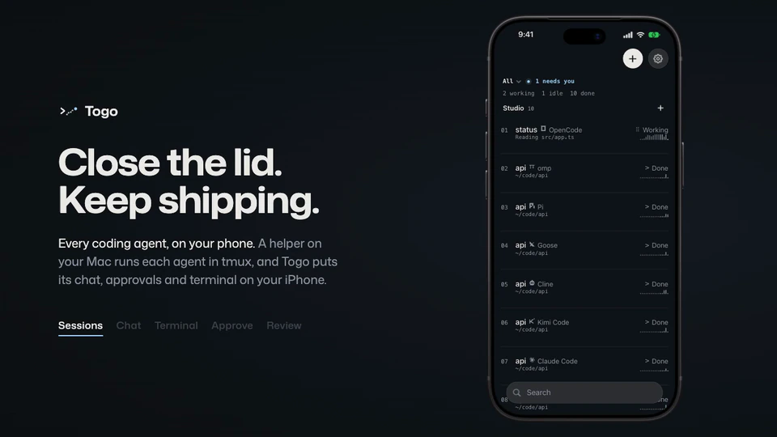
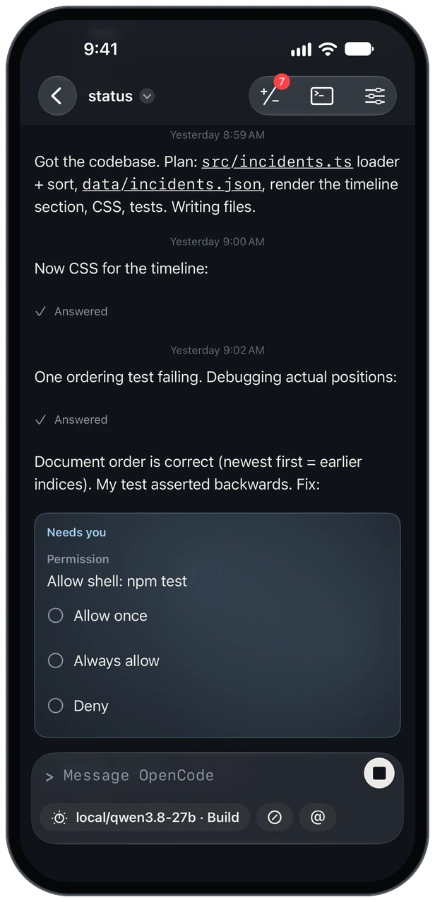
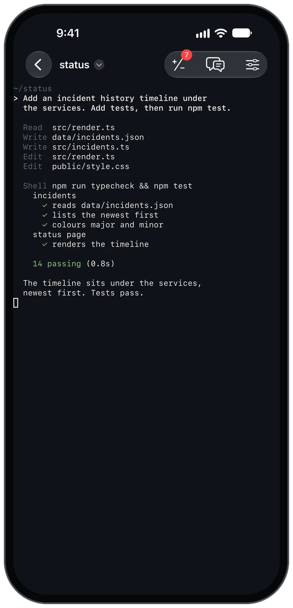
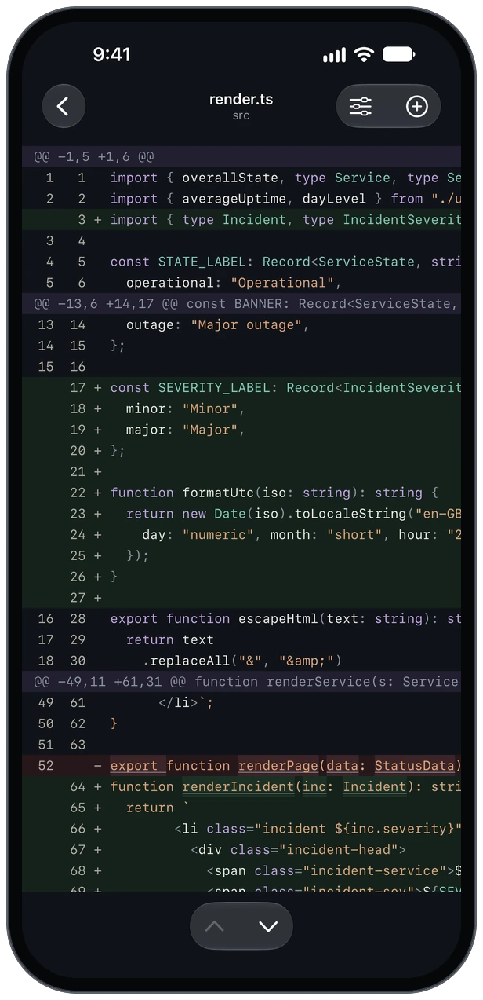
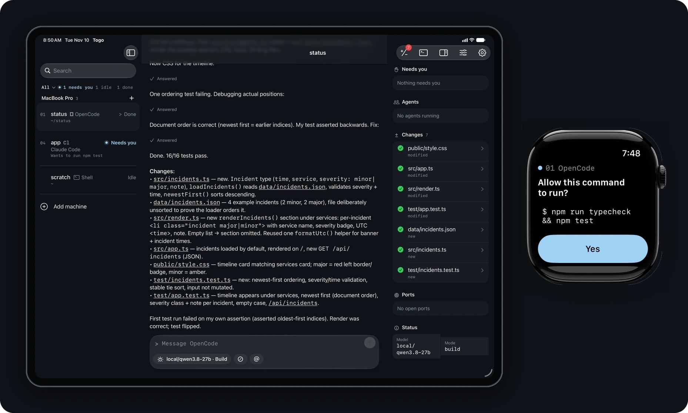
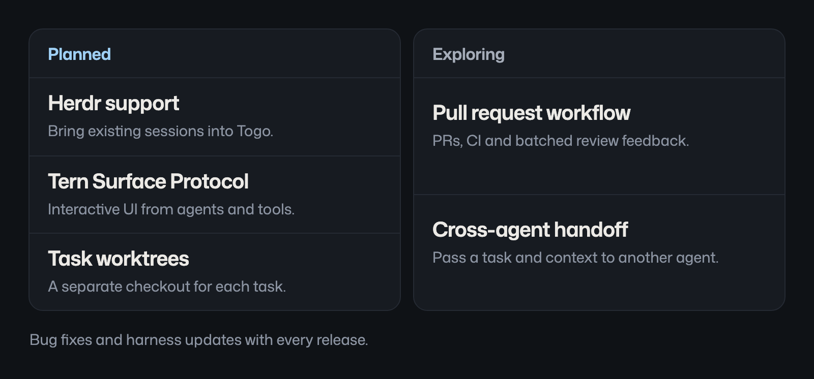
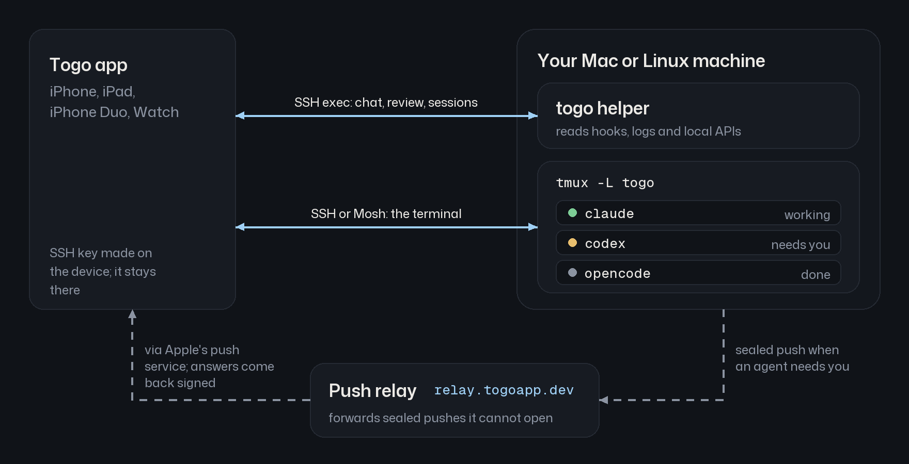

<h1 align="center">Togo</h1>

<p align="center"><strong>Your coding agents. One native app.</strong></p>

<p align="center">
  Native chat for OpenCode, OMP, Pi and 13 more coding agents.<br>
  On iPhone and iPad, with an Apple Watch companion. Your agents run on your own Mac or Linux machine.
</p>

<p align="center"><strong>100% free and open source. No subscription. No paid tier. No Togo account.</strong></p>

<p align="center">
  <a href="https://apps.apple.com/app/togo-agent-remote/id6833273877">Download on the App Store</a> ·
  <a href="#quick-start">Quick start</a> ·
  <a href="#supported-agents">Supported agents</a> ·
  <a href="#how-togo-compares">Compare</a> ·
  <a href="https://togoapp.dev/docs/">Docs</a> ·
  <a href="#roadmap">Roadmap</a> ·
  <a href="#contributing">Contribute</a> ·
  <a href="https://togoapp.dev">Website</a>
</p>

<p align="center">
  <a href="https://github.com/gettogo/togo/releases/latest"></a>
  <a href="https://github.com/gettogo/togo/actions/workflows/ci.yml"></a>
</p>

<p align="center">
  <a href="https://togoapp.dev">
    
  </a>
</p>

## One app for the agents you already use

Togo is for people who use OpenCode, OMP, Pi or a mix of coding agents and want to keep working away from their desk. Your harness keeps its configuration, tools and model access, including local models. Togo gives it a native SwiftUI chat on your phone.

Each of the [16 agent adapters](helper/internal/harness/adapters) maps the agent's hooks, session logs or local API into messages, tool work and the controls that agent supports. Read a turn, send the next instruction, answer a question or change models. Open the real terminal when you need the agent's own interface or a shell.

**The chat and terminal belong to the same running session.** Start a Togo session from your phone or the CLI; it lives in tmux on your Mac or Linux machine. Run `togo attach 1` at your desk to join it. Chat and controls connect directly over SSH, with no session traffic passing through a Togo relay. A separate relay handles encrypted notifications and signed approval replies.

<table>
  <tr>
    <td width="33%"></td>
    <td width="33%"></td>
    <td width="33%"></td>
  </tr>
  <tr>
    <td><strong>Chat with your agents.</strong><br>One native interface for 16 harnesses, with messages, tool steps and the controls each agent exposes.</td>
    <td><strong>Open the real terminal.</strong><br>The same session, in the agent's own interface. Switch between chat and terminal.</td>
    <td><strong>Review and commit.</strong><br>Read the diffs, stage files and commit from your phone.</td>
  </tr>
</table>

### Step away without losing the thread

You're in line for coffee and an agent stops to ask whether it can run a database migration. Your phone buzzes. Read the command on the Lock Screen and tap Deny. The session stays in tmux, ready for your next instruction.

- **Answer where the request finds you.** Approvals appear in chat, notifications, Live Activities and on Apple Watch. Answer questions and their choices in the app.
- **Start work from your phone.** Pick a machine, a folder and an agent. It starts in tmux and appears at your desk too.
- **See the rest of the session.** Mission control gathers subagents, background shells, plans, changes, ports and status where the agent reports them.
- **Finish the review from your phone.** Browse files and commit history, send comments on a diff, stage or discard changes, and commit. Open a host's dev server through an SSH-forwarded preview.
- **Send images and dictate locally.** Attach screenshots, mark up an image before sending it, or dictate with Apple's on-device speech or a downloaded Whisper model.
- **Keep a full terminal with you.** SSH, Mosh and Eternal Terminal are included, with session reattachment and terminal text selection, copy and paste.
- **Use the screen you have.** On iPad and an open iPhone Duo, keep the session list beside your work. On Watch, approve or deny a waiting request.

<p align="center">
  
</p>

## How Togo compares

**16 native agent chats. A real terminal. No paid unlocks.**

| Mobile app | **Togo** | Moshi | Paseo | HAPI |
|---|:---:|:---:|:---:|:---:|
| App download | **Free** | Free | Free | Paid |
| Native agent chat | **✓** | Pro | ✓ | ✓ |
| Full terminal | **✓** | ✓ | ✓ | Web only |
| Mosh transport | **✓** | Pro | N/D | N/D |
| Eternal Terminal | **✓** | Pro | N/D | N/D |
| Chat connection | **SSH** | SSH | Relay / Tailscale | Hub |
| Sessions run in | **tmux** | tmux / other muxes | Paseo daemon | CLI / Runner |
| Push notifications | **✓** | ✓ | ✓ | ✓ |
| In-app approvals | **✓** | Pro | ✓ | ✓ |
| Lock Screen approval buttons | **✓** | Pro | N/D | N/D |
| Live Activities / Dynamic Island | **✓** | ✓ | N/D | N/D |
| Apple Watch approvals | **✓** | Pro | N/D | N/D |
| Git diff review | **✓** | Pro | ✓ | ✓ |
| Stage / commit UI | **✓** | N/D | ✓ | N/D |
| Browse files / past commits | **✓** | Pro | ✓ | Files only |
| Diff comments to the agent | **✓** | Desktop | ✓ | N/D |
| Dev-server previews | **✓** | Pro | Desktop | N/D |
| Image attachments | **✓** | Pro | ✓ | ✓ |
| Image markup | **✓** | Pro | N/D | N/D |
| Dictation | **On-device** | On-device / cloud | Host / cloud | Hub provider |
| Open-source app | **✓** | No | ✓ | ✓ |

✓ Included at the app price above. **Pro** requires a paid upgrade. **N/D** Not documented for the mobile app. Moshi offers five trial inbox actions. HAPI's Web/PWA is free. Model and hosting costs are separate for all four.

<details>
<summary><strong>Sources and agent coverage · checked 13 November 2026</strong></summary>

- **Togo:** [Transports and approvals](docs/architecture.md), [review UI](apps/ios/Togo/Review), [image markup](apps/ios/Togo/Compose/ImagePasteFlow.swift) and [on-device speech](apps/ios/Togo/Compose/Dictation). Eternal Terminal needs `etserver` on the host and an explicit transport choice. Agent controls and image input depend on the harness.
- **Moshi:** [Chat View requirements](https://getmoshi.app/docs/chat-view#requirements), [Free vs Pro](https://getmoshi.app/docs/subscription), [Live Activities](https://getmoshi.app/docs/live-activity), [notifications](https://getmoshi.app/docs/notifications), [diff viewer](https://getmoshi.app/docs/diff-viewer), [browser previews](https://getmoshi.app/docs/browser-preview) and its [comparison with Paseo](https://getmoshi.app/compare/paseo).
- **Paseo:** [Free and open source](https://paseo.sh/), [development environment](https://paseo.sh/docs/why), [mobile connectivity](https://paseo.sh/docs/connectivity), [voice](https://paseo.sh/docs/voice) and [changelog](https://paseo.sh/changelog). It also offers worktrees, orchestration and desktop/web clients.
- **HAPI:** [Native app pricing and features](https://hapi.run/docs/guide/native-apps), including its web-only terminal.

Aider, Cline, Crush, Kilo Code and Mistral Vibe all have native chat in Togo; Moshi currently lists them as [terminal-only integrations](https://getmoshi.app/docs/hooks#tier-c-every-terminal-agent). Check the [controls for your harness](#supported-agents).

</details>

[Full comparison, including T3 Code, Orca, Happy, KittyLitter, Termius, Blink Shell, ShellFish and first-party remotes](docs/alternatives.md).

**Current limits:** iOS/iPadOS 26, Mac/Linux and tmux. Herdr, task worktrees and cross-agent handoff are on the [roadmap](#roadmap).

## Quick start

Togo has two parts: the app on your phone and a small helper on the machine running your agents.

**You need:** iOS or iPadOS 26 or later, a Mac or Linux machine with tmux 3.2 or newer, and SSH access to it. The Watch companion needs watchOS 26 or later. Your agents and their model access are separate from Togo.

### 1. Get the app

[Download Togo on the App Store](https://apps.apple.com/app/togo-agent-remote/id6833273877). It's free.

Beta builds come out first on [TestFlight](https://testflight.apple.com/join/GjzJW2vU).

You can explore with a demo machine before connecting your own: open **How it works**, then **Explore with a demo machine** on the first-run screen.

### 2. Install the helper

Run this on your Mac or Linux machine:

```sh
curl -fsSL https://togoapp.dev/install.sh | sh
```

The installer checks the release's signature and checksum before writing anything, installs to `~/.togo/bin`, and starts the background service so alerts can arrive while the app is closed.

<details>
<summary><strong>Homebrew, source installs and release verification</strong></summary>

With Homebrew:

```sh
brew install gettogo/tap/togo
togo service install
```

Updates come through `brew upgrade togo`.

From source, with Go 1.26 or newer:

```sh
GOBIN="$HOME/.togo/bin" go install github.com/gettogo/togo/helper/cmd/togo@latest
~/.togo/bin/togo service install
```

Add `~/.togo/bin` to your `PATH` to use plain `togo` at the desk.

The helper is one binary for macOS and Linux, arm64 and amd64. [Release downloads](https://github.com/gettogo/togo/releases/latest) include checksums and a minisign signature. See [Verifying a release](SECURITY.md#verifying-a-release).

To install without the background service:

```sh
curl -fsSL https://togoapp.dev/install.sh | sh -s -- --no-service
```

</details>

### 3. Connect your machine

On a Mac, enable **System Settings > General > Sharing > Remote Login**. In Togo, add your machine's hostname and user name, add the app's public key to `~/.ssh/authorized_keys`, and verify the host key fingerprint shown on the first connection. Notification pairing happens over that same SSH connection.

For access away from home, connect your phone and machine through Tailscale or use another reachable SSH address. [The setup guide](https://togoapp.dev/docs/getting-started/) walks through the connection; [pairing and device revocation](https://togoapp.dev/docs/pairing/) covers notification keys.

### 4. Start a session

Use the plus button in the app, or run this at your desk:

```sh
togo doctor
togo hooks install
togo new opencode --dir ~/code/project
```

`togo doctor` checks the machine and changes nothing. `togo hooks install` configures installed agents that accept hooks and backs up the files it changes.

```sh
togo ls         # list sessions
togo attach 1   # join a session from your terminal
```

On a Mac, plugged-in mode keeps the machine awake while sessions work. Closed-lid use on battery needs [additional awake setup](https://togoapp.dev/docs/troubleshooting/#awake). [Troubleshooting](https://togoapp.dev/docs/troubleshooting/) explains the other checks from `togo doctor`.

Without the helper, a reachable SSH machine still works as a terminal. The helper adds native agent chat, session controls, alerts and remote approvals.

## Supported agents

**All 16 get a native chat.** Model selection, approvals, questions and other controls depend on the agent. The app reads each agent's existing hooks, logs or API; an unrecognised version opens in the terminal rather than guessing.

| Agent | Command | Native controls | Togo reads |
|---|---|---|---|
| OpenCode | `opencode` | model, mode, approvals, questions, resume | local HTTP API and event stream |
| OMP | `omp` | model, effort, questions | session log |
| Pi | `pi` | model, effort, resume | session log |
| Claude Code | `claude` | model, mode, effort, approvals, questions, resume | hooks, status line, transcript |
| Codex | `codex` | model, mode, effort, approvals, questions, resume | app-server, as a second client |
| Copilot CLI | `copilot` | model, approvals, questions, resume | hooks |
| Cursor CLI | `cursor-agent` | model, approvals | hooks |
| Aider | `aider` | model, mode | chat history file |
| Amp | `amp` | approvals | a Togo plugin |
| Cline | `cline` | approvals, questions, resume | session file |
| Crush | `crush` | mode, questions, resume | client-server API |
| Droid | `droid` | approvals, questions, resume | hooks |
| Goose | `goose` | mode, approvals, questions, resume | session database, read-only |
| Kilo Code | `kilo` | model, mode, approvals, questions, resume | local HTTP API and event stream |
| Kimi Code | `kimi` | model, mode, approvals, questions, resume | wire log |
| Mistral Vibe | `vibe` | mode, approvals, questions, resume | session journal |

Any other CLI agent works in the terminal view. A screen watcher can surface numbered menus and y/n prompts so you can answer them from your phone. [Agent compatibility](https://togoapp.dev/agents/)

## Roadmap

<p align="center">
  <a href="https://github.com/gettogo/togo/discussions/1">
    <picture>
      <source media="(max-width: 600px)" srcset=".github/assets/roadmap-mobile.webp">
      
    </picture>
  </a>
</p>

Follow the [roadmap discussion](https://github.com/gettogo/togo/discussions/1) for scope and updates. Planned features have no release dates yet.

## Contributing

Togo is free and open source across the app, helper and relay. You can work on the helper, adapters, relay and protocol on macOS or Linux **without an Apple developer account**.

| Help with | Where to start |
|---|---|
| Make a first contribution | [Add custom SSH port support to the diagnostics (#3)](https://github.com/gettogo/togo/issues/3), a Go-only `good first issue`. |
| Build a planned feature | The [Herdr backend prototype (#4)](https://github.com/gettogo/togo/issues/4) and [Tern Surface Protocol prototype (#5)](https://github.com/gettogo/togo/issues/5) are open for help. Discuss a smaller piece in the issue before starting. |
| Test your agent | [Report an agent issue](https://github.com/gettogo/togo/issues/new?template=adapter.yml) with its version and what Togo missed. |
| Report a bug | [Open a bug report](https://github.com/gettogo/togo/issues/new?template=bug.yml) with steps to reproduce and the app/helper versions. |
| Improve agent support | Explore the [adapters](helper/internal/harness/adapters): YAML definitions and Go mappers for messages, tools, status and controls. |

Read [CONTRIBUTING.md](CONTRIBUTING.md) for setup and review requirements. Sign off commits with `git commit -s`.

Introduce yourself in the [welcome discussion](https://github.com/gettogo/togo/discussions/2), ask setup questions in [Q&A](https://github.com/gettogo/togo/discussions/categories/q-a), or suggest a workflow in [Ideas](https://github.com/gettogo/togo/discussions/categories/ideas). Remove private details from anything you share publicly; vulnerabilities go through [SECURITY.md](SECURITY.md).

If you find Togo useful, a star is a welcome way to support the project.

## How it works

<p align="center">
  
</p>

- Sessions live in a separate tmux server, `tmux -L togo`. Your own tmux server is left alone.
- Native chat and session controls travel over an SSH exec channel: `togo serve --stdio`. The helper opens no listening port.
- The terminal attaches to the same session over SSH or Mosh.
- The helper seals notifications for each paired device. A small relay forwards them to Apple and carries signed approval answers back through a short-lived mailbox.

The helper is also scriptable: `togo ask "Ship it?" --options yes,no` waits for an answer on your phone. `togo notify`, `togo job` and `togo awake` cover notifications, long tasks and keeping the machine awake. [Architecture](docs/architecture.md)

## Privacy and security

- **Direct connection.** Chat, terminal output and reviewed code travel between your phone and your machine over SSH or Mosh. Togo doesn't upload your repository to a Togo server. Your agent's model provider still receives your prompts and code as it does at the desk.
- **Device-held keys.** SSH keys are made on the device and kept in the Secure Enclave or device-only Keychain. Host keys are pinned.
- **Encrypted notification contents.** Each payload is sealed for one device with X25519, HKDF-SHA256 and ChaCha20-Poly1305. The relay cannot read commands, questions or output. Live Activity status fields, including the agent name, state and request count, travel in the clear because iOS renders them directly.
- **Signed approvals.** Lock Screen and Watch answers are signed with the device's Ed25519 key, checked for freshness and accepted once. The relay carries approve and deny only; typed replies and always-allow decisions stay in the app.
- **No tracking.** The app has no analytics, ads or crash reporter. The helper never reads agent credential files or logs secrets. You can use [your own relay](relay/).

Read the [security model](docs/security.md) for the full boundaries and [SECURITY.md](SECURITY.md) to report a vulnerability privately.

## Build from source

| Path | Component |
|---|---|
| [`apps/ios`](apps/ios) | iPhone, iPad and Watch app, built with SwiftUI and XcodeGen |
| [`packages`](packages) | Swift packages for the session model, terminal, Mosh and push crypto |
| [`helper`](helper) | Go helper |
| [`relay`](relay) | Cloudflare Worker push relay |
| [`protocol`](protocol) | JSON-RPC schema and shared fixtures |

```sh
make build lint test   # helper
make relay-test        # relay
make ios-bootstrap     # Mac with Xcode: prepare simulators and generate the project
make ios-test
```

See [CONTRIBUTING.md](CONTRIBUTING.md) for prerequisites and the checks relevant to each component.

<details>
<summary><strong>Why Togo?</strong></summary>

In 1925, Togo led Leonhard Seppala's sled-dog team on the serum run to Nome, covering about 260 miles, including the sea ice on Norton Sound. Balto led the final leg and got the statue in Central Park. Togo did the long haul in the dark, which is the job we had in mind.

</details>

## Licence

The app and Swift packages are **GPLv3 with an app store permission**: [LICENSE](LICENSE). The [helper](helper/LICENSE), [relay](relay/LICENSE) and [protocol](protocol/LICENSE) are **MIT**. Product names and logos belong to their respective owners.
