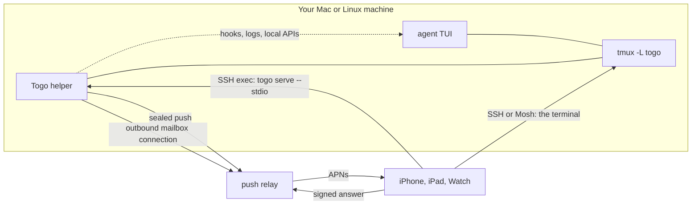

<p align="center">
  <picture>
    <source media="(prefers-color-scheme: dark)" srcset="brand/togo-mark-dark.svg">
    
  </picture>
</p>

<h1 align="center">Close the lid. Keep shipping.</h1>

<p align="center"><strong>Every coding agent, on your phone.</strong></p>

<p align="center">
  Togo is an iPhone, iPad and Apple Watch app for the coding agents running in tmux on your own machine.
</p>

<p align="center">
  <a href="#install-the-helper">Install the helper</a> ·
  <a href="#supported-agents">Agents</a> ·
  <a href="#how-it-works">How it works</a> ·
  <a href="#privacy-and-security">Privacy</a> ·
  <a href="#why-the-name">Why the name</a>
</p>

You're in line for coffee and the agent you left on the big refactor has stopped. It wants to run a database migration and it won't without you. Your phone buzzes. You read the command on the lock screen and tap Deny. By the time your order is up, the agent has moved on to a safer plan, still in tmux, on your own machine.

> [!NOTE]
> **Status.** The `togo` helper works today on macOS and Linux. The app is not on the App Store yet and there is no public test build. This README says which parts need the app.

<!--
TODO(capture): hero art. Use real-app captures once they exist:
a Claude Code turn folding into its one-line summary beside a Watch approval. Commit light and dark versions and wrap them in <picture>
with prefers-color-scheme, the way the mark above is, so the frame reads on both GitHub themes.
Until then there is no real footage, so there is no image here.
-->

## Why

Coding agents got good enough to leave alone for an hour, and then they stop to ask something. Most of the time you are not at the desk. Togo leaves the agent where it already runs, in a terminal on a machine you own, and gives your phone a proper way in: a chat where the agent has a chat, the real terminal where it doesn't, and a needs-you alert the moment it is waiting on you.

## What you get

- **A native chat for 17 agents.** Replies, tool steps folded into one line per turn, and approvals inline. Model, mode and effort pickers work through the agent itself, by its own commands or its API, so the terminal shows the same choice.
- **The real terminal, one tap away.** The agent's own interface, live in tmux, over SSH or Mosh. It stays the source of truth, and every agent has it, listed or not.
- **Mission control.** Subagents, background shells, the plan, the changes, forwarded ports and status, pulled down over the chat for agents that report them.
- **Needs you.** When an agent waits on you, a Live Activity lights on the lock screen and in the Dynamic Island, and your Watch taps. Approve or deny from any of them.
- **iPhone, iPad, Apple Watch and iPhone Duo.** On Duo the layout follows the fold. Held as a tabletop, the terminal stays above the hinge and requests and the keyboard sit below it.
- **Every route at once.** Togo tries the machine's local name, its home network address, Tailscale and any saved address together, and keeps the first that answers with the host key it already knows.
- **A helper you can script.** `togo ask "Ship it?" --options yes,no` waits for your answer on the phone. `togo notify`, `togo job` and `togo awake` cover the rest of the long-task chores.

Without the helper, any machine you can reach over SSH still works as a full terminal with its own tmux sessions. Nothing has to be installed on a machine you only want a shell on.

## Supported agents

Togo knows 19 agents by name, plus the plain shell. Where an adapter exists, the app draws a native chat from what the agent already writes down: its hooks, its session log or its local API. An agent outside the version range its adapter was checked against opens in the terminal instead of guessing.

<!-- Generated from helper/internal/agents/agents.go and helper/internal/harness/adapters/*/*.yaml (the capabilities line). Regenerate when an adapter changes. -->

| Agent | Command | On the phone | Native controls | Togo reads |
|---|---|---|---|---|
| Claude Code | `claude` | chat | model, mode, effort, approvals, questions, resume | hooks, status line, transcript |
| OMP | `omp` | chat | model, effort | session log |
| Codex | `codex` | chat | model, mode, effort, approvals, questions, resume | its app-server, as a second client |
| OpenCode | `opencode` | chat | model, mode, approvals, questions, resume | its local HTTP API and event stream |
| Copilot CLI | `copilot` | chat | model, approvals, resume | hooks |
| Cursor CLI | `cursor-agent` | chat | model, approvals | hooks |
| Aider | `aider` | chat | model, mode | chat history file |
| Amp | `amp` | chat | approvals | a Togo plugin |
| Auggie | `auggie` | chat | model, mode, effort, resume | hooks |
| Cline | `cline` | chat | resume | session file |
| Crush | `crush` | chat | mode, resume | its client-server API |
| Droid | `droid` | chat | approvals, resume | hooks |
| Goose | `goose` | chat | mode, resume | session database, read-only |
| Kilo Code | `kilo` | chat | model, mode, approvals, questions, resume | its local HTTP API and event stream |
| Kimi Code | `kimi` | chat | model, mode, resume | wire log |
| Kiro CLI | `kiro-cli` | terminal | none | none |
| OpenHands | `openhands` | terminal | none | none |
| Pi | `pi` | chat | model, effort, resume | session log |
| Mistral Vibe | `vibe` | chat | mode, approvals, resume | session journal |

Anything else that runs in a terminal runs in Togo, as a terminal. It can still reach you: a screen watcher spots a numbered menu or a y/n prompt in the pane and asks you, and your answer is typed back as the keys that pick it. Plain shells with prompt marks (OSC 133) get each command as its own block.

Adapters are YAML plus a small Go mapper in [`helper/internal/harness/adapters`](helper/internal/harness/adapters). A new agent is a good first contribution.

## Install the helper

The helper is one Go binary, `togo`, for macOS and Linux on arm64 and amd64. It needs tmux 3.2 or newer. The app looks for it in `~/.togo/bin` first, so install it there.

With Go 1.26 or newer:

```sh
GOBIN="$HOME/.togo/bin" go install github.com/gettogo/togo/helper/cmd/togo@latest
```

From a clone:

```sh
git clone https://github.com/gettogo/togo.git && cd togo
make build
mkdir -p ~/.togo/bin && cp helper/bin/togo ~/.togo/bin/
```

From the first tagged release, an install script checks the minisign signature on `SHA256SUMS` and the archive's checksum, and writes nothing until both pass:

```sh
curl -fsSL https://github.com/gettogo/togo/releases/latest/download/install.sh | sh
```

Add `~/.togo/bin` to your `PATH` to run `togo` at the desk.

### First run

```sh
togo doctor            # checks tmux, mosh-server, the firewall and Tailscale SSH; changes nothing
togo service install   # runs the daemon at login, so needs-you alerts arrive while the app is closed
togo hooks install     # sets up every installed agent that takes hooks; backs up each file once first
togo new claude --dir ~/code/project
```

`togo ls` lists sessions and `togo attach 1` joins one from another terminal. Sessions you start at the desk show up on the phone, and the other way round. Run `togo` with no arguments for every command. `togo uninstall` takes the hooks and the login service back out.

When the app ships, you add the machine by hostname or Tailscale name, put the app's public key in `~/.ssh/authorized_keys`, and check the host key fingerprint it shows the first time. Pairing for notifications happens over that same SSH connection. There is no code to type and no port to open.

## How it works



- Sessions are tmux sessions on their own socket, `tmux -L togo`. Your own tmux server is left alone.
- The app talks to the helper through an SSH exec channel. The helper opens no listening port of its own.
- The terminal is a plain SSH or Mosh connection attached to the session.
- Adapters read what each agent already records and act by typing its documented commands, relaunching it with flags, or answering through its approval path.
- When an agent waits, the helper seals a push for each paired phone and sends it through the relay. Answers from the lock screen or the Watch come back signed, through a short-lived mailbox the helper reads over an outbound connection.

## Privacy and security

- **No account.** Your phone connects to machines you own, with an SSH key made on the device. The private half stays in the Secure Enclave or the device-only Keychain.
- **Sealed notifications.** Each push is sealed on your machine for one device (X25519, HKDF-SHA256, ChaCha20-Poly1305). The relay forwards ciphertext it cannot open.
- **What the relay can read.** Live Activities are the exception iOS imposes: it renders them straight from the push, so their status fields travel in the clear. That is the session number, the agent's name, its status, how many requests wait and when it started. Command text never goes in the clear; it rides in the sealed part.
- **Signed answers.** Every approval from the lock screen or the Watch is signed by that device's Ed25519 key, checked for freshness and used once. The relay path carries approve and deny only; typed replies and "always allow" are refused there and stay in the app.
- **Host keys are pinned.** A route that shows a different key drops out before any credential is sent.
- **Your relay, if you like.** The relay is a small Cloudflare Worker in [`relay/`](relay), and the app can point at your own.
- **Agents' secrets stay put.** The helper never reads an agent's credential files and never logs secrets.

Report vulnerabilities privately; see [SECURITY.md](SECURITY.md).

## Build from source

| Path | What |
|---|---|
| `apps/ios` | The iPhone, iPad and Watch app (SwiftUI, Xcode project generated by XcodeGen) |
| `packages` | Swift packages: TogoKit, the terminal, Mosh and push crypto |
| `helper` | The `togo` helper (Go) |
| `relay` | The push relay (Cloudflare Worker, TypeScript) |
| `protocol` | The JSON-RPC schema and fixtures both sides test against |

```sh
make build lint test   # the helper: build, gofmt and go vet, tests
make relay-test        # the relay
make ios-bootstrap     # on a Mac with Xcode: simulators, signing team, Togo.xcodeproj
make ios-test
```

The helper, the adapters, the relay and the protocol build and test on macOS or Linux without an Apple developer account. The app needs Xcode and iOS 26 or later.

## Contributing

Read [CONTRIBUTING.md](CONTRIBUTING.md) first. Sign off every commit with `git commit -s`. Adapters, terminal themes and keyboard presets are the easiest places to start. Questions go to [Discussions](https://github.com/gettogo/togo/discussions).

## Why the name

In the winter of 1925, relays of dog teams carried diphtheria serum across Alaska to Nome. Togo led Leonhard Seppala's team, and they covered about 260 miles, far more than any other team on the run, including a crossing of the sea ice on Norton Sound. Balto led the last leg into Nome and got the statue in Central Park. For decades Togo was mostly left out of the story. He did the long haul in the dark, which is the job we had in mind.

## Licence

The app (`apps/` and `packages/`) is GPLv3; see [LICENSE](LICENSE). The helper, relay and protocol are MIT; see [helper/LICENSE](helper/LICENSE), [relay/LICENSE](relay/LICENSE) and [protocol/LICENSE](protocol/LICENSE).
